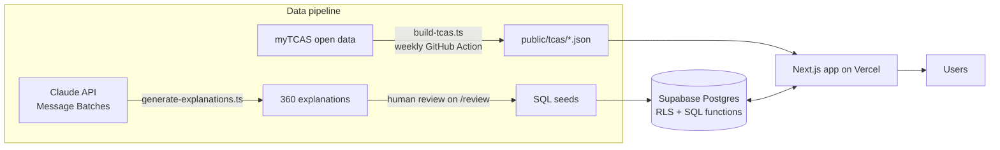

# Click Your Dream

**A RIASEC career-interest quiz for Thai students and workers that turns the result into real university programs, using live data from TCAS, Thailand's university admission system.**

🔗 **Live:** [click-your-dream.vercel.app](https://click-your-dream.vercel.app) · 👥 **250+ users** · 🏆 **1st place, FutureEd Fest 2026**

---

## What it does

1. **Take the quiz.** 42 Holland (RIASEC) questions, with the result tailored to the user's group: high school student, university student or working adult.
2. **Get your dream card.** Your 3-letter Holland code with a character, a written explanation and the careers and fields that fit. You can download or share the card as an image.
3. **Find real programs.** High school results link to bachelor's programs that are open in the current TCAS year.
4. **Explore TCAS.** Search every program from 76 universities (4,000+ programs). For each one you can see the seats per round and the round 3 exam subjects, weights and minimum scores.

## Architecture



## Engineering highlights

### Automated ETL pipeline
- `scripts/build-tcas.ts` pulls course, round and admission criteria data from myTCAS. It fetches with bounded concurrency (16 requests) and retries, uses only Node built-ins, and writes one JSON file per university plus an index.
- The **GitHub Actions** workflow `.github/workflows/tcas-refresh.yml` runs every Monday. It commits only when programs, seats or criteria actually changed, ignoring timestamp-only diffs. Each commit triggers an automatic **Vercel** deploy.
- The workflow raises a warning when myTCAS adds subject codes that the app doesn't have a name for yet.

### Database design (Supabase / PostgreSQL)
- **Row-level security on every table.** Users can only read and write their own answers, progress and results, and only *reviewed* explanations are public.
- **Scoring runs in SQL functions** (`score_quiz`, `submit_quiz`, `save_quiz_progress`), so the client can't tamper with the result.
- Users take the quiz as **anonymous guests** through Supabase anonymous sign-in, with no sign-up needed, and their progress is saved as they go.

### PDPA & privacy
- Users give consent before the quiz starts, with a versioned consent record. University students are also asked to confirm their age.
- `delete_my_data()` lets users wipe their data from the privacy page.
- A daily **pg_cron** job (`purge_inactive_guests`) removes inactive guest accounts.

### AI content with a human in the loop
- 120 Holland codes × 3 user groups = **360 explanations**, pre-generated with the **Claude API** through Message Batches at half the cost of standard requests. Nothing is generated at request time, so there's no per-user API cost.
- Every explanation is checked by a person on an internal `/review` page before publishing. Review progress is stored as one JSON file per reviewer so files never conflict, and `npm run review:push` syncs it and rebuilds the seeds.

## Tech stack

| Layer | Tools |
|---|---|
| Frontend | Next.js 16 (App Router), React 19, TypeScript, Tailwind CSS 4 |
| Backend / DB | Supabase (PostgreSQL, RLS, SQL functions, anonymous auth, pg_cron) |
| Data pipeline | Node.js scripts, GitHub Actions (scheduled) |
| AI | Claude API (Message Batches) |
| Deploy | Vercel, Vercel Web Analytics |

## Project structure

```
src/app/            pages (quiz, result, explore, privacy, review) and API routes
src/lib/riasec/     RIASEC types, scores and profiles
src/lib/tcas/       TCAS types, subjects and exam calendar
scripts/            ETL and content-generation scripts
supabase/           migrations, seeds and explanation data
public/tcas/        generated TCAS data, one file per university
```

## Running locally

```bash
npm install
cp .env.example .env.local   # fill in your Supabase URL and anon key
npm run dev                  # http://localhost:3000
```

Then run the files in `supabase/migrations/` followed by `supabase/seed.sql` in your Supabase project.

| Script | What it does |
|---|---|
| `npm run tcas` | Re-fetch TCAS data from myTCAS |
| `npm run explanations -- --sample 3` | Generate a few sample explanations and show the projected cost (needs `ANTHROPIC_API_KEY`) |
| `npm run review:push` | Sync review progress and rebuild the SQL seeds |

## Credits

Developed by **Jirattakan Junhor** ([@TannyDiWa](https://github.com/TannyDiWa)) for a friend's competition team, who pitched it and won 1st place at FutureEd Fest 2026.
TCAS data comes from [myTCAS](https://course.mytcas.com). Please check official sources before applying.
